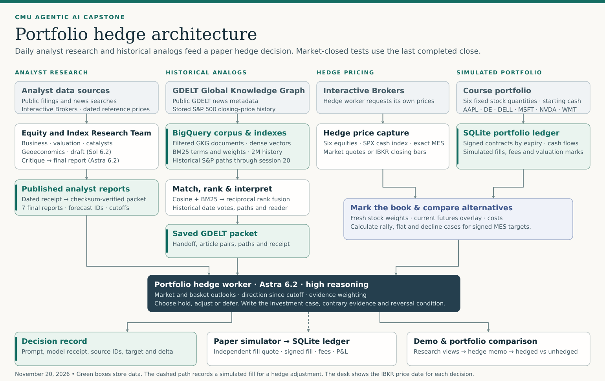

# Portfolio Hedge Desk

This research system helps a portfolio manager decide whether to change an index hedge on a six-stock paper portfolio. It brings together seven analyst reports, historical news analogs and independently collected market prices. The output is a decision to **hold, adjust or defer**, with a rationale and a record of the resulting paper position. A short futures position offsets some losses when the index falls and gives up some gains when it rises.

## Follow the decision shown in the demo

| Demo screen | Where to look in the code | What to check |
| --- | --- | --- |
| Equity and Index Research Team | [Analyst roles and instructions](analysts/prompts.md), [research coordinator](analysts/run.py), [batch publication](analysts/worker/daily_research.py) | Four specialists investigate each subject. A writer, critic and final writer turn their findings into a report. The publisher checks that each accepted forecast belongs to the same dated batch before issuing a seven-report packet. |
| GDELT analogs | [News intake](gdelt/demo.py), [rank fusion](gdelt/sql/evaluate/fusion.sql), [market paths](gdelt/sql/evaluate/reports.sql), [reader and citation checks](gdelt/research.py) | Semantic search and BM25 keyword search each rank the historical documents. The system combines ranks, splits a story’s vote across tied winners, and shows how the S&P 500 behaved over the next 20 trading sessions. A frequently matched date measures similarity. Its vote share is not a probability of a future market move. |
| Hedge decision | [Input verification](hedge/hedge_session.py), [decision instructions](hedge/hedge_prompt.md), [candidate calculations](hedge/hedge_math.py), [closing-price review](hedge/after_close.py) | The worker verifies the dated research and uses independent broker prices. Python calculates exposure, fees and scenario results for each permitted position. The model weighs that evidence and explains its choice. A follow-up review first reproduces the position left by the preceding decision. |
| Paper portfolio and decision journal | [Ledger](hedge/ledger.py), [forward scoring](hedge/decision_history.py), [Hedge Desk interface](desk/index.html) | The ledger records a change once, even on a retry. The journal can compare the resulting hedge with both an unhedged basket and the position already in place. |

On November 22, 2026, the worker verified the seven Sunday reports and reviewed the refreshed GDELT evidence using the November 20 market closes. It carried forward the existing short position of one Micro E-mini S&P 500 contract (MES). The change in contracts was zero, so the additional transaction fee was zero. This is a recorded paper decision. Measuring its investment outcome requires later prices.

## Check the fee calculation locally

From the repository root, run this with Python 3.12. It calls the same sizing function used by the worker. The price of 100 is chosen to make the arithmetic easy to check by hand. At $5 per index point, a one-point decline earns a one-contract short $5.

~~~bash
cd hedge
python3 - <<'PY'
from hedge_math import evaluate_hedges

contract = "MES-202612"
book = {
    "portfolio_value_usd": 1000,
    "equities": {},
    "futures": {contract: {"contracts": -1, "mark": 100}},
}
rows = evaluate_hedges(book, contract, 100, [-1, 0], 2, {"decline": {"index_return": -0.01}})
hold, close = rows["candidates"]
assert hold["change_cost_usd"] == "0.00"
assert hold["scenarios"]["decline"]["overlay_after_cost_usd"] == "5.00"
assert close["change_cost_usd"] == "2.00"
print("Verified: holding costs $0, the decline earns $5, and closing costs $2.")
PY
~~~

## Running the services

The calculation above needs only the Python standard library. The [research viewer](analysts/dashboard/app.py) also supports a local record directory. In a separate environment, install [its dependencies](analysts/dashboard/requirements.txt) and set `REPORT_STORE` to the directory containing published records.

The live workflows use separate environments for the [analyst worker](analysts/worker/reassessment_requirements.txt), [BigQuery pipeline](gdelt/requirements.txt), [GDELT reader](gdelt/requirements-research.txt) and [hedge worker](hedge/requirements-hedge.txt). An operator supplies authorized model and read-only market-data access, Google Cloud resources, an opening paper book, and dated inputs. The Cloud Storage and research dashboard locations are configured with `HEDGE_RESEARCH_STORE` and `RESEARCH_DASHBOARD_URL`. The [BigQuery defaults](gdelt/runtime_defaults.json) use the operator’s project, baseline dataset and reservation. The [GDELT study](desk/gdelt/study.html) and Hedge Desk pages are source templates. Their JSON slots receive published records at rendering time.

ChatGPT and Codex assisted with development and editing.
