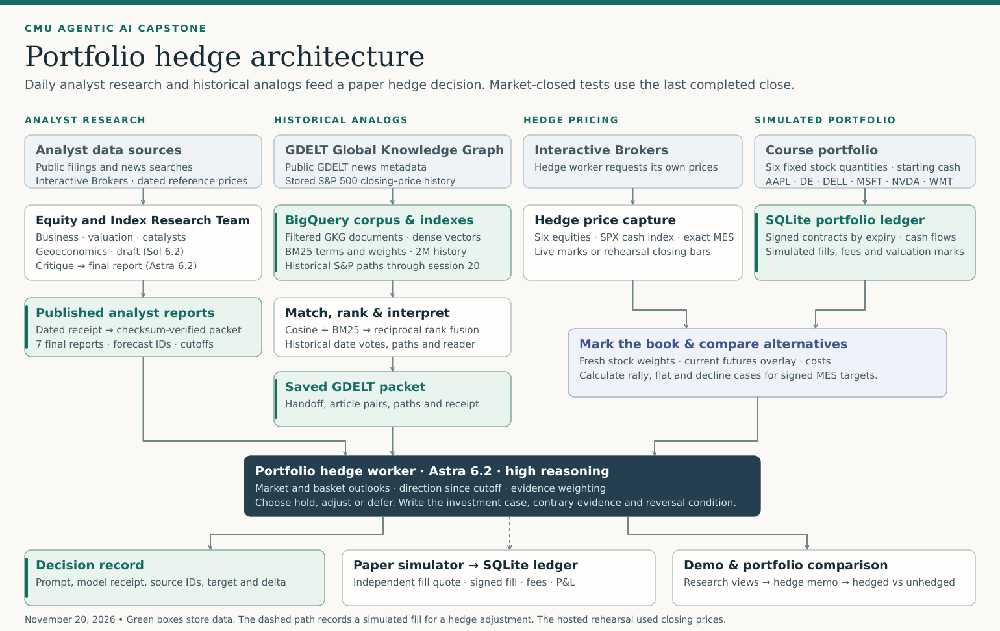

# Agentic portfolio hedging

A portfolio manager holds six stocks and wants to reduce exposure to a broad market decline without selling the holdings. This CMU Agentic AI capstone brings together company and index research, historical news analogs, and independent market prices to decide whether to hold, adjust, or defer a hedge in Micro E-mini S&P 500 futures (MES).

## How to review the project

Start with the [integrated system diagram](figures/system.svg). Then follow a decision through the source files below. All links open on GitHub. Reviewing the implementation requires no installation, cloud account, broker connection or model key.

| Step | What happens | Source |
| --- | --- | --- |
| 1. Research the portfolio | The Equity and Index Research Team covers six stocks and the S&P 500. For each subject, four specialists research the business, valuation, catalysts and geoeconomics. A writer drafts the 20-session forecast. A critic challenges it and a final writer revises it. The team searches again before publication and can abstain when the evidence is inadequate. | [Research flow](analysts/run.py) · [Role prompts](analysts/prompts.md) · [Dated publication](analysts/publish.py) |
| 2. Find historical analogs | BigQuery compares recent GDELT news metadata with two million historical documents using embedding similarity and BM25 keyword ranking. The combined rankings produce historical date votes, which weight subsequent S&P 500 price paths. The model reader inspects article pairs and market paths before citing them. | [Retrieval SQL](gdelt/sql/retrieval.sql) · [Return paths](gdelt/sql/market_paths.sql) · [Reader](gdelt/research.py) · [Evidence handoff](gdelt/research_evidence.py) |
| 3. Decide on the hedge | The hedge worker verifies the analyst packet and the GDELT handoff. It obtains its own Interactive Brokers prices, values the simulated book and calculates the effects of alternative signed MES positions. Astra weighs the evidence and records a target, a rationale, contrary evidence and a condition for reconsideration. | [Hedge worker](hedge/hedge_session.py) · [Sizing](hedge/hedge_math.py) · [Decision instructions](hedge/hedge_prompt.md) |
| 4. Account for the outcome | The paper ledger records fills and fees. The Hedge Desk compares the hedged portfolio with the same stocks and cash held without futures. Forward scoring also measures what changing the hedge contributed relative to keeping the previous position. | [Paper ledger](hedge/ledger.py) · [Forward scoring](hedge/decision_history.py) · [Hedge Desk](hedge/desk.py) |

## How it ran

The analyst, GDELT and hedge workers shared one Google Compute Engine VM. The analyst worker used LangChain and OpenAI hosted web search. It published a dated receipt and an immutable report packet to Cloud Storage. The GDELT worker used BigQuery, Gemini Embedding 2 and an OpenAI reader to produce six evidence files. The hedge worker received both deliveries and requested separate prices through the read-only Interactive Brokers Model Context Protocol connection. A Flask dashboard on Cloud Run displayed research, and the Hedge Desk displayed the decision and portfolio comparison.

- [Research diagram](figures/research.svg) shows the seven roles, their searches and the reports they exchange.
- [Google Cloud deployment diagram](figures/deployment.svg) shows worker placement, managed services and external connections.
- [Research dashboard](analysts/dashboard/app.py), [GDELT dashboard](gdelt/research_view.html) and [Hedge Desk template](hedge/assets/desk.html) show how the three views present the underlying evidence.

On November 20, 2026, the hosted closing-price rehearsal verified seven analyst reports, accepted the six-file GDELT handoff, and retrieved eight Interactive Brokers price histories. The worker chose one short MES contract and the simulator recorded the adjustment. That run verified the handoffs and accounting. Evaluating hedge effectiveness requires subsequent market observations. [Closing-price session](hedge/after_close.py)

This repository contains the core implementation used in the project. The source is arranged for inspection. Live operation also requires provisioned services, a broker adapter, runtime configuration and authorized input data. Development and editing used ChatGPT and Codex.
